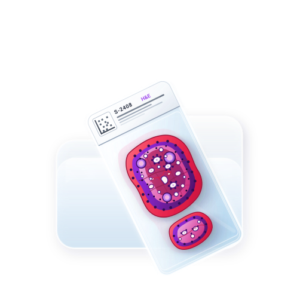

# omnigisto_pkg



[](https://pub.dev/packages/omnigisto_pkg)
[](https://pub.dev/packages/omnigisto_pkg)
[](https://opensource.org/licenses/BSD-3-Clause)
[-orange.svg)](https://dart.dev)

[](https://pub.dev/packages/omni_wsi_anotations)

[](https://www.buymeacoffee.com/omnigisto)


A lightweight, fast, and memory-efficient Dart & Flutter library for reading Aperio SVS and Hamamatsu NDPI/VMS/VMU (Whole Slide Image / WSI) files. It enables positional metadata parsing, pyramid resolution level inspection, on-demand tile extraction, and associated image retrieval (thumbnail, label, macro) without loading multi-gigabyte files into RAM.

---

## Features

- **Memory-Efficient & Fast**: Uses `RandomAccessFile` and `ByteData` to stream and read TIFF/SVS headers and tile offsets positionally without loading the entire multi-gigabyte image into memory.
- **BigTIFF Support**: Full support for BigTIFF (Magic 43 / 64-bit offsets, `LONG8`, `IFD8`), enabling seamless reading of massive slide files (> 4 GB, up to tens of gigabytes).
- **Extensive Compression Support**: Decodes JPEG (with JPEGTables & Adobe APP14 color handling), JPEG 2000 (Aperio compression tags 33003, 33005, 34712), LZW (with horizontal predictor), Deflate, and uncompressed RGB/Grayscale.
- **Color & Display Support**: Full support for Aperio `DisplayColor` tinting/remapping, embedded ICC profile extraction and attachment, TIFF PhotometricInterpretation (`WhiteIsZero`, Palette/ColorMap), and color space conversions.
- **Full Pyramid Inspection**: Retrieve dimensions, tile configurations, compression formats, and resolution levels for the whole slide pyramid.
- **On-Demand Tile Extraction**: Extract specific image tiles by level and tile grid coordinates (`tileX`, `tileY`) in different formats.
- **Associated Images**: Extract non-tiled associated images such as `thumbnail`, `label` (slide barcode/label), and `macro` (full slide preview) in different formats.
- **Aperio Metadata Parser**: Automatically parses Aperio header properties, compression quality (`Q`), microns-per-pixel (`MPP`), `DisplayColor`, scan dimensions, and custom key-value pairs.
- **Hamamatsu Support**: Reads NDPI extended 64-bit offsets, VMS JPEG mosaics, and VMU/NGR 12-bit RGB data through the same API and result classes; no native OpenSlide dependency is required.
- **Virtual Tiling & Region Decoding**: Automatically aggregates 8-pixel micro-tiles in Hamamatsu NDPI into standard tiles (e.g., 256x256 or 512x512) for smooth, lag-free UI rendering. Provides OpenSlide-compatible arbitrary rectangular region decoding (`readRegion(x, y, w, h)`).
- **Cross-Platform**: Works across all platforms supported by Dart `dart:io` (Flutter for Android, iOS, macOS, Windows, Linux).

---

## Getting Started

### 1. Add dependency

Add `omnigisto_pkg` to your `pubspec.yaml`:

```yaml
dependencies:
  omnigisto_pkg:
    path: ../omnigisto_pkg # or from pub.dev / git
```

Then run:

```bash
flutter pub get
# or for pure Dart projects:
dart pub get
```

### 2. Import package

```dart
import 'package:omnigisto_pkg/omnigisto_pkg.dart';
```

---

## Usage

### 1. Opening an SVS / BigTIFF File

Open the SVS file handle using `openSvsFile`. Always close the handle when finished (or use a `try`/`finally` block).
You can optionally configure `maxConcurrency` (default: 4) to tune parallel I/O for your storage medium (e.g., `1` for slow mechanical HDDs, `4` to `8` for fast SSD/NVMe).

```dart
import 'package:omnigisto_pkg/omnigisto_pkg.dart';
import 'dart:io';
import 'dart:math' as math;
import 'package:flutter/foundation.dart';

/// Calculates the optimal level of parallelism (maxConcurrency)
/// for opening and processing an SVS file based on the available hardware,
/// platform type, and file size.
int _calculateSvsMaxConcurrency({
  int? fileSizeBytes,
  int activeFilesCount = 1,
}) {

  /// Gets the number of logical processor cores.
  final int totalCores = Platform.numberOfProcessors;

  // Leaves 1-2 cores for the UI thread and the Flutter engine
  final int availableCores = math.max(1, totalCores > 4 ? totalCores - 2 : totalCores - 1);

  // Sets safe bounds depending on the platform
  final bool isMobile = Platform.isAndroid || Platform.isIOS;
  final int minConcurrency = 2;
  final int maxPlatformLimit = isMobile ? 4 : 8;

  int concurrency = availableCores;

  // // Adjusts based on the file size (if the size is provided)
  if (fileSizeBytes != null && fileSizeBytes > 0) {
    final double sizeInMb = fileSizeBytes / (1024 * 1024);

    if (sizeInMb < 150) {
      // For small files, 2-3 threads are enough to avoid pool overhead
      concurrency = math.min(concurrency, 3);
    } else if (sizeInMb > 2048 && isMobile) {
      // On mobile devices, limit parallelism for files > 2 GB 
      // to avoid Out Of Memory (OOM / Jetsam) due to heavy buffers
      concurrency = math.min(concurrency, 3);
    } else if (sizeInMb > 1024 && !isMobile) {
      // On desktop, more resources can be utilized for large files
      concurrency = math.min(concurrency, maxPlatformLimit);
    }
  }

  // Accounts for multiple open screens (load sharing)
  if (activeFilesCount > 1) {
    concurrency = (concurrency / (activeFilesCount * 0.75)).ceil();
  }

  // Clamps the final value to the allowed range
  return concurrency.clamp(minConcurrency, maxPlatformLimit);
}

void main() async {
  // Open with default or custom concurrency limit
  try {
    int? fileSizeBytes;
    try {
      final file = File(path);
      if (await file.exists()) {
        fileSizeBytes = await file.length();
      }
    } catch (e) {
      if (kDebugMode) {
        print("Failed to determine the file size: $e");
      }
    }

    final int activeOpenFiles = _svsFiles.where((f) => f != null).length + 1;

    final int concurrency = _calculateSvsMaxConcurrency(
      fileSizeBytes: fileSizeBytes,
      activeFilesCount: activeOpenFiles,
    );

    return openSvsFile(path, maxConcurrency: concurrency);
  } catch (e) {
    if (kDebugMode) {
      print("error opening svs: $e");
    }
    return null;
  }
}
```

---

### 2. Reading Basic Metadata

To quickly read primary image dimensions and parsed Aperio properties (including `MPP` and `DisplayColor`):

```dart
final metadata = await readSvsMetadata(svs);
if (metadata != null) {
  print('Width: ${metadata.width}, Height: ${metadata.height}');
  print('Tile Size: ${metadata.tileWidth}x${metadata.tileHeight}');
  print('Compression: ${metadata.compression}');
  print('Display Color: ${metadata.displayColor?.toRadixString(16)}');
  print('App Properties: ${metadata.properties}');
  print('MPP: ${metadata.properties['MPP']}');
}
```

---

### 3. Reading Full Pyramid Metadata & Levels

To inspect all resolution pyramid layers and associated images:

```dart
final fullMeta = await readFullSvsMetadata(svs);
if (fullMeta != null) {
  print('Pyramid Levels: ${fullMeta.levels.length}');
  for (int i = 0; i < fullMeta.levels.length; i++) {
    final level = fullMeta.levels[i];
    print('Level $i: ${level.width}x${level.height}, Tile: ${level.tileWidth}x${level.tileHeight}, Downsample: ${level.downsample}');
  }

  print('Associated images: ${fullMeta.associations.keys.toList()}');
  fullMeta.associations.forEach((key, info) {
    print('$key: ${info.width}x${info.height}');
  });
}
```

---

### 4. Extracting Associated Images (Thumbnail, Label, Macro)

Extract `img.Image` to display them directly in Flutter UI (automatically applies color scheme and `DisplayColor` tinting by default):

```dart
import 'dart:typed_data';
import 'package:flutter/material.dart';
import 'package:image/image.dart' as img;

// Extract thumbnail, label, or macro
final img.Image? thumb = await extractSvsImageAsImage(svs, 'thumbnail');
final img.Image? label = await extractSvsImageAsImage(svs, 'label');
final img.Image? macro = await extractSvsImageAsImage(svs, 'macro');

// Optional color control:
// extractSvsImageAsImage(svs, 'thumbnail', applyColorScheme: true, applyDisplayColor: true, displayColor: 0x00FF00);

// Example Flutter Widget rendering
Widget buildImage(img.Image? pic) {
  if (pic == null) return const Text('Image not available');
  
  final Uint8List tmp = Uint8List.fromList(img.encodeJpg(pic));
  return Image.memory(tmp);
}
```

Extract raw bytes for associated images:
```dart
import 'dart:typed_data';

// Extract thumbnail, label, or macro as raw bytes
final Uint8List? thumbBytes = await extractSvsImage(svs, 'thumbnail');
final Uint8List? labelBytes = await extractSvsImage(svs, 'label');
final Uint8List? macroBytes = await extractSvsImage(svs, 'macro');
```

---

### 5. Extracting Individual Tiles

Extract specific tiles as raw bytes (recommended for production) :
```dart
import 'dart:typed_data';

final fullMeta = await readFullSvsMetadata(svs);
if (fullMeta != null && fullMeta.levels.isNotEmpty) {
  const int levelIndex = 0; // 0 = highest resolution baseline
  final level = fullMeta.levels[levelIndex];

  if (level.tileWidth != null && level.tileHeight != null) {
    int totalCols = (level.width + level.tileWidth! - 1) ~/ level.tileWidth!;
    int totalRows = (level.height + level.tileHeight! - 1) ~/ level.tileHeight!;

    print('Grid size: $totalCols columns x $totalRows rows');

    // Extract raw tile bytes at coordinate (tileX: 0, tileY: 0)
    final Uint8List? tileBytes = await extractSvsTile(svs, levelIndex, 0, 0);
    if (tileBytes != null) {
      print('Extracted tile (${tileBytes.length} bytes)');
    }
  }
}
```

Extract specific tiles on demand as decoded `img.Image` (supports JPEG, JPEG 2000, LZW, Deflate, Raw RGB, with optional `DisplayColor` and color scheme adjustments):

```dart
import 'dart:typed_data';
import 'package:flutter/material.dart';
import 'package:image/image.dart' as img;

final fullMeta = await readFullSvsMetadata(svs);
if (fullMeta != null && fullMeta.levels.isNotEmpty) {
  const int levelIndex = 0; // 0 = highest resolution baseline
  final level = fullMeta.levels[levelIndex];
  
  int totalCols = (level.width + level.tileWidth! - 1) ~/ level.tileWidth!;
  int totalRows = (level.height + level.tileHeight! - 1) ~/ level.tileHeight!;
  
  print('Grid size: $totalCols columns x $totalRows rows');
  
  // Extract tile at coordinate (tileX: 0, tileY: 0)
  final img.Image? tile = await extractSvsTileAsImage(
    svs,
    levelIndex,
    0,
    0,
    applyColorScheme: true,
    applyDisplayColor: true, // applies DisplayColor from slide metadata if present
  );
  if (tile != null) {
    Uint8List tileBytes = Uint8List.fromList(img.encodeJpg(tile));
    // Display or process tile...
  }
}
```

Extract tiles with cancellation support (`CancellationToken`):

```dart
import 'dart:typed_data';
import 'package:omnigisto_pkg/omnigisto_pkg.dart';

final cancelToken = CancellationToken();

// Start extracting a tile with the cancellation token
final Future<Uint8List?> tileFuture = extractSvsTile(
  svs,
  0, // levelIndex
  0, // tileX
  0, // tileY
  cancelToken: cancelToken,
);

// If the user scrolls, zooms away, or disposes the widget:
cancelToken.cancel();

final Uint8List? tileBytes = await tileFuture;
if (tileBytes != null) {
  print('Tile loaded: ${tileBytes.length} bytes');
} else {
  print('Tile loading was cancelled or failed.');
}
```


---

## Hamamatsu NDPI, VMS and VMU

Use the existing functions without renaming or converting the returned data:

```dart
final slide = await openSvsFile('/slides/sample.ndpi');
// Also accepts /slides/sample.vms or /slides/sample.vmu.
if (slide != null) {
  try {
    final SvsMetadata? metadata = await readSvsMetadata(slide);
    final SvsFullMetadata? full = await readFullSvsMetadata(slide);
    final tile = await extractSvsTileAsImage(slide, 0, 0, 0);
    print(metadata);
    print(full);
    print(tile?.width);
  } finally {
    await slide.close();
  }
}
```

`SvsMetadata`, `SvsFullMetadata`, `SvsImageInfo`, their fields and `toString()` formats are unchanged. `levels` remain sorted from largest to smallest, with `downsample` relative to level 0. Properties remain `Map<String, String>`; Hamamatsu adds `Vendor=Hamamatsu`, `Compression`, `AppMag` and `MPP`/`MPP_X`/`MPP_Y` when available. Invalid coordinates, missing associations and cancelled tile requests still return `null`.

- **NDPI**: Detected by its contents, not its extension. Handles eight-byte header/IFD pointers and the NDPI IFD value-extension table, including files larger than 4 GiB. JPEG strips become native restart-interval tiles; unreliable or absent restart tables fall back to incremental marker scanning. Only focal plane 0 is exposed. Positive `SourceLens` values are pyramid levels; `SourceLens=-1` is `macro`. Other auxiliary directories are not exposed.
- **VMS**: Open the INI index and retain its referenced JPEG files and `MapFile` in their relative locations. `ImageFile`, `ImageFile(x,y)`, `ImageFile(z)` and `ImageFile(z,x,y)` are supported for plane 0. The JPEG mosaic is the baseline, the map is a reduced level and `thumbnail`, and optional `MacroImage` is `macro`. File boundaries must align with the native tile grid; incompatible mosaics are rejected rather than resampled. `.opt` is not required or used; missing restart offsets are discovered incrementally.
- **VMU**: Open the INI index together with its NGR `ImageFile`/`MapFile` and optional JPEG `MacroImage`. Supports `BitsPerPixel=36`, `PixelOrder=RGB`, and the `GN` NGR header. The 12-bit RGB samples stored in little-endian 16-bit words are normalized to 8-bit RGB. Tiles use the NGR column width and 64 rows, with the last row cropped; image width must be divisible by column width.

Always use the reported `tileWidth`/`tileHeight`: Hamamatsu JPEG tiles can be wide and only 8 or 16 pixels high. To eliminate UI rendering bottlenecks caused by tiny 8-pixel strips, **Virtual Tiling** automatically aggregates vertical intervals (e.g. 32 or 64 MCU rows, producing 256x256 or 512x512 tiles). You can also configure or toggle virtual tiling via `openSvsFile` options or `enableVirtualTiling(slide)` / `disableVirtualTiling(slide)`:

```dart
// Open with customized virtual tile dimensions
final slide = await openSvsFile(
  '/slides/sample.ndpi',
  virtualTiling: true,
  mcuRowsPerTile: 32, // 32 MCU rows = 256 px high
  virtualTileWidth: 256,
  virtualTileHeight: 256,
);

// Or decode arbitrary rectangular regions (like OpenSlide readRegion):
final img.Image? region = await readRegion(
  slide,
  0, // layerIndex
  100, // x
  200, // y
  512, // width
  512, // height
);
```

`extractSvsTile` returns standalone JPEG bytes for NDPI/VMS (headers adjusted without recompressing entropy), or row-major 8-bit RGB bytes for VMU. `extractSvsTileAsImage` consistently returns `img.Image`. Associated-image functions keep their existing raw/image/JPEG return types; associations not present in the source, such as a separate label, are not fabricated. Explicit `displayColor` overrides and `applyDisplayColor` remain available.

JPEG support covers sequential 8-bit, single-scan images with one or three components. Progressive, arithmetic, multiscan JPEGs and incompatible restart layouts are rejected. A JPEG without restart markers is a single tile and must fit the whole-image limit (16 Mi pixels); full associated-image decoding has the same pixel limit. Large restart-coded levels are read on demand. `maxConcurrency` applies to each underlying file pool; `close()` closes all sidecar sources as well.

Regression fixtures are generated locally, including sparse NDPI offsets above 4 GiB, JPEG restart markers, VMS mosaics and NGR columns. Real-file validation also used the public [CMU-1.ndpi sample](https://openslide.cs.cmu.edu/download/openslide-testdata/Hamamatsu/CMU-1.ndpi); VMU validation uses synthetic fixtures. Format reference: [OpenSlide Hamamatsu documentation](https://openslide.org/formats/hamamatsu/).

Run the self-contained Hamamatsu tests (no downloads required):

```bash
flutter test test/hamamatsu_ndpi_test.dart test/hamamatsu_vms_test.dart test/hamamatsu_jpeg_test.dart test/virtual_tiling_and_region_test.dart
```

The existing SVS integration tests additionally require their original slide fixtures under `example/assets/`; these large files are not included in the package.

---

## API Reference

### Functions

| Function | Description |
| :--- | :--- |
| `Future<SvsFile?> openSvsFile(String path, {int maxConcurrency = 4, bool? virtualTiling, int? virtualTileWidth, int? virtualTileHeight, int? mcuRowsPerTile})` | Opens SVS/TIFF/BigTIFF, Hamamatsu NDPI, or a VMS/VMU index with optional virtual tiling. |
| `Future<SvsMetadata?> readSvsMetadata(SvsFile svs)` | Reads basic metadata of the primary image (including `displayColor`). |
| `Future<SvsFullMetadata?> readFullSvsMetadata(SvsFile svs)` | Reads all pyramid levels and associated image metadata. |
| `Future readRegion(SvsFile svs, int layerIndex, int x, int y, int width, int height, {bool applyColorScheme = true, bool applyDisplayColor = true, int? displayColor, CancellationToken? cancelToken})` | OpenSlide-compatible arbitrary rectangle region decoding across SVS and Hamamatsu slides. |
| `Future extractSvsRegionAsImage(SvsFile svs, int layerIndex, int x, int y, int width, int height, ...)` | Alias for `readRegion`. |
| `Future<Uint8List?> extractSvsRegion(SvsFile svs, int layerIndex, int x, int y, int width, int height, ...)` | Extracts a rectangular region as encoded JPEG bytes. |
| `void enableVirtualTiling(SvsFile svs, {int? virtualTileWidth, int? virtualTileHeight, int? mcuRowsPerTile})` | Enables virtual tiling on an open Hamamatsu slide. |
| `void disableVirtualTiling(SvsFile svs)` | Disables virtual tiling, reverting to raw micro-tiles. |
| `Future extractSvsImageAsImage(SvsFile svs, String type, {bool applyColorScheme = true, bool applyDisplayColor = true, int? displayColor})` | Extracts decoded `img.Image` for `'thumbnail'`, `'label'`, or `'macro'`. |
| `Future<Uint8List?> extractSvsImageAsJpeg(SvsFile svs, String type, {int quality = 90, bool applyColorScheme = true, bool applyDisplayColor = true, int? displayColor})` | Extracts JPEG encoded byte data for `'thumbnail'`, `'label'`, or `'macro'`. |
| `Future<Uint8List?> extractSvsImage(SvsFile svs, String type)` | Extracts raw bytes for `'thumbnail'`, `'label'`, or `'macro'`. |
| `Future<Uint8List?> extractSvsLevelImage(SvsFile svs, int layerIndex, {CancellationToken? cancelToken})` | Extracts raw whole-image bytes for a resolution layer. |
| `Future extractSvsTileAsImage(SvsFile svs, int layerIndex, int tileX, int tileY, {bool applyColorScheme = true, bool applyDisplayColor = true, int? displayColor, CancellationToken? cancelToken})` | Extracts and decodes `img.Image` for a specific tile. |
| `Future<Uint8List?> extractSvsTile(SvsFile svs, int layerIndex, int tileX, int tileY, {CancellationToken? cancelToken})` | Extracts raw bytes for a specific tile. |
| `int? parseDisplayColor(dynamic value)` | Utility function to parse Aperio `DisplayColor` strings (decimal, hex, `#RRGGBB`, `0xRRGGBB`) or integers into an integer RGB value. |

### Classes

| Class | Description |
| :--- | :--- |
| `SvsFile` | Encapsulates the `RandomAccessFile`, endianness, `isBigTiff` flag, first IFD offset, and cached global tables/colors. Call `close()` when done. |
| `CancellationToken` | Allows cancelling in-flight I/O reads, waiting queues, and heavy tile decompressions (JPEG 2000, LZW, color transformations). |
| `SvsMetadata` | Contains `width`, `height`, `tileWidth`, `tileHeight`, `compression`, `displayColor`, and `properties` map for the primary image. |
| `SvsFullMetadata` | Contains `levels` (`List<SvsImageInfo>`) and `associations` (`Map<String, SvsImageInfo>`). |
| `SvsImageInfo` | Detailed metadata for a single layer or associated image (`width`, `height`, `tileWidth`, `tileHeight`, `compression`, `displayColor`, `downsample`, `properties`, `type`). |

---

## Example Project

A complete runnable Flutter example demonstrating file picking, metadata inspection, and associated image extraction is available in the [`example/`](example/) directory.

---

## License

This project is licensed under the BSD 3-Clause License - see the [LICENSE](LICENSE) file for details.
